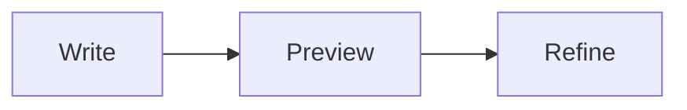

# Rich Markdown Preview

**A Styled Markdown Preview for Visual Studio Code** · by **Kasun Kodagoda**

Turn Markdown into a comfortable reading experience in VS Code. Rich Markdown Preview combines **18 reading styles**, live Markdown preview, syntax highlighting, **Mermaid diagrams**, and interactive tables. Use it for READMEs, documentation, technical notes, articles, and research.

## What's new in v2.0.0

- **Documentation Home:** Browse Markdown throughout your workspace in one preview tab, with an expandable folder tree and filename filtering.
- **One-click access:** Open Documentation Home from the **Rich Markdown Documentation** status bar button or our logo in the Explorer title bar.
- **Nested and hidden documentation:** Discover files in folders such as `docs/`, `reports/`, and `.claude/`, with configurable exclusions and automatic refresh.
- **Connected reading:** Follow Markdown links in place, use Back/Forward navigation, open source files for editing, and retain each document's scroll position and table filters.

[View full release notes](CHANGELOG.md)


## Get started

1. Install **Rich Markdown Preview - A Styled Markdown Preview** from the VS Code Extensions view. Requires VS Code **1.95 or newer**.
2. Open a Markdown file (`.md`).
3. Right-click in the editor and choose **Open in Rich Markdown Preview**. The preview opens beside your source by default. Disable **Rich Markdown Preview: Open Preview To Side** in Settings to open a new tab in the current editor group.
4. Choose a **Style** and **Appearance** in the preview toolbar. Edit your Markdown to see live updates.

You can also right-click a Markdown file in **Explorer**, use the **Open in Rich Markdown Preview** action in the editor title bar, or open the **Command Palette** (`Ctrl+Shift+P` on Windows/Linux, `Cmd+Shift+P` on macOS) and run **Open in Rich Markdown Preview**. Press **Ctrl+Alt+M** on Windows/Linux or **Cmd+Alt+M** on macOS to open the preview from the editor. Customize this in VS Code Keyboard Shortcuts by searching for **Open in Rich Markdown Preview**. Opening the same file again brings its existing preview into view using your current placement setting. All `.md` files (including `.MD`) work even when another language is selected in the language picker.

## Features

- **18 styles:** Documentation, Reading, Technical, GitHub, Editorial, Book, Minimal, Academic, Swiss, Aurora, Botanical, Noir, Blueprint, Terracotta, Atelier, Ocean, Manuscript, and Circuit.
- **Documentation Home:** Browse Markdown across your workspace in one tab, with an expandable folder tree, filename filtering, and previews that open in place.
- **Light, dark, or automatic appearance:** Auto follows the VS Code theme, including diagram colors.
- **Reading controls:** Adjust content width, text size, and line spacing; wrap long code lines; show or hide the heading outline.
- **Frontmatter:** YAML metadata appears in a collapsible card above the document, with readable fields, nested values, and a YAML source view.
- **Preview placement:** Open beside the source or as a new tab in the current editor group.
- **Keyboard shortcut:** Ctrl+Alt+M on Windows/Linux or Cmd+Alt+M on macOS.
- **Live preview:** Updates while typing and keeps the preview's scroll position.
- **Code highlighting:** Language labels, readable syntax colors, and a Copy button on fenced code blocks.
- **Mermaid diagrams and charts:** Rendered locally with colors coordinated to your reading style.
- **Interactive tables:** Sort columns, search rows, choose spacing, and copy or export the visible data as CSV.
- **Heading navigation:** Jump to sections using the outline or heading links.
- **Extended Markdown:** Task lists, emoji shortcodes, footnotes, definition lists, highlighted text, subscript, superscript, and GitHub-style callouts.
- **File references:** Click includes, imports, embeds, and Markdown file links to open their source in VS Code. Relationship icons and syntax tooltips make dependencies easy to identify.
- **Links and images:** Local file links open in VS Code. Relative images load from the document directory; HTTPS images are supported.
- **Offline rendering:** Styles, syntax highlighting, and Mermaid are bundled. No CDN or account is needed. Remote images and external links use your network connection.


## Browse workspace documentation

Open a folder or workspace, then click **Rich Markdown Documentation** in the VS Code status bar or the **Rich Markdown Preview logo** in the Explorer title bar. The status bar uses a Markdown glyph; the Explorer button uses the extension's image icon. You can also run **Rich Markdown Preview: Open Documentation Home** from the Command Palette. No Markdown editor needs to be open.

Documentation Home opens in the current editor group. Its home page lists the workspace's documentation folders and root Markdown files, with a **Read README** shortcut when available. Each workspace folder has its own root. Expand the left-hand folder tree or filter by filename or folder path, then select a document to read it on the right.

- **Documents / On this page:** Switch between the file tree and the selected document's heading outline. **Navigation** hides or shows the sidebar; on narrow tabs it appears above the document.
- **Home, Back, Forward:** Navigate within the same preview tab. Each document keeps its table filters and reading position while you browse.
- **Open source:** Open the selected Markdown source beside Documentation Home for editing. The preview updates while you type.
- **Markdown links:** Links and file references to Markdown inside the workspace open in Documentation Home, including heading fragments. Other local files open in VS Code; external links open in your browser.
- **Refresh:** Rescan manually. File additions, deletions, and workspace-folder changes also refresh the tree automatically. If the selected file is deleted or its workspace folder is removed, the view returns home.

Discovery includes nested and hidden documentation folders such as `docs/`, `reports/`, and `.claude/`. It uses its own include/exclude settings rather than the Explorer's exclusions or `.gitignore`. Common dependency and build folders are excluded by default. Only paths are indexed; document content is read when selected. Nothing is generated or written into your repository.

| Setting | Default / behavior |
| --- | --- |
| `richMarkdownPreview.documentation.include` | `**/*.{md,MD,markdown,MARKDOWN}`; workspace-relative glob, configurable per workspace folder |
| `richMarkdownPreview.documentation.exclude` | `**/{.git,node_modules,bower_components,dist,build,out,coverage,.next,.venv,venv}/**`; set empty to remove exclusions |
| `richMarkdownPreview.documentation.showStatusBar` | `true`; disable to hide the status bar button |

Filtering searches file paths, not document contents. Files in excluded folders can still be opened through a document link, but do not appear in the tree. VS Code's filesystem watcher exclusions can prevent automatic updates in some folders; use **Refresh** to rescan them.

## Make it yours

Use the toolbar to change **Style**, **Appearance**, **Width**, **Text**, **Spacing**, and **Wrap code**. The **Outline** button toggles section navigation. Width updates as you drag; it saves when you release the slider.

Reading preferences save for the file's workspace folder, or globally for standalone files. If a settings file cannot be saved, the preview keeps your selection for the current session and shows a warning.

You can also search for **Rich Markdown Preview** in VS Code Settings. The settings use the `richMarkdownPreview.*` namespace:

| Setting | Default | Options |
| --- | --- | --- |
| `richMarkdownPreview.style` | `documentation` | Any of the 18 styles |
| `richMarkdownPreview.appearance` | `auto` | `auto`, `light`, `dark` |
| `richMarkdownPreview.contentWidth` | `900` | 480–1600 pixels |
| `richMarkdownPreview.fontSize` | `16` | 12–24 pixels |
| `richMarkdownPreview.lineHeight` | `1.7` | 1.3–2.2 |
| `richMarkdownPreview.referenceRoot` | Empty | Root for `/` references; workspace-relative directory or absolute Windows path |
| `richMarkdownPreview.openPreviewToSide` | `true` | Set `false` for a new tab in the current editor group |
| `richMarkdownPreview.wrapCode` | `false` | `true` or `false` |

The placement setting applies when you next open or reveal a preview. Opening in the current group uses its available width without creating a split; existing editor groups keep their layout. The Width control still sets the maximum reading width.

All styles use system fonts; their exact appearance can vary by operating system.

## Navigate file references

References show an icon before the link: **↳ include**, **⇥ import**, **▣ embed**, or **↗ related file**. Hover to see the target and syntax; click or press Enter on the focused link to open the file in VS Code.

| Syntax | Example |
| --- | --- |
| Include directive | `{{include: /snippets/guide.md}}` |
| Claude import | `@references/guide.md` or `@"references/My Guide.md"` |
| DocFX include | `[!INCLUDE [Guide](references/guide.md)]` |
| DocFX code reference | `[!code-js[Example](scripts/example.js#L1-L5)]` |
| PyMdown snippet | `--8<-- "snippets/guide.md"` (single-line and multiline forms) |
| Jekyll | `` or `` |
| Retype | `{{ include "snippets/guide" }}` |
| Obsidian link / embed | `[[Guide\|Read guide]]` or `![[Guide]]` |
| Include comment | `<!-- @include: snippets/guide.md -->` |
| Markdown Include | `{!! snippets/guide.md !!}` |
| Docsify | `[Guide](snippets/guide.md ":include")` |
| Markdown link | `[Guide](references/guide.md)` |

Relative targets use the current document directory. Targets starting with `/` use the document's workspace folder, or its directory for standalone files. Set **Rich Markdown Preview: Reference Root** to point at a skill package or another base directory. For a `SKILL.md` in `.claude/skills/my-skill`, set it to `.claude/skills/my-skill` when `/snippets/...` refers to that skill's snippets folder. Claude home-relative `~/...` and absolute Windows paths are also supported.

Jekyll includes use `_includes` under the reference root; `include_relative` uses the document directory. Retype checks the document directory, its `_includes`, and the root's `_includes`, with optional `.md`. Obsidian targets try the document directory and reference root, with optional `.md`.

Includes and embeds are shown as references rather than expanded content. Line ranges and heading fragments open the containing file. Remote include references open in your browser on click. Template variables stay literal; code examples, frontmatter values, and ordinary `@mentions` are not converted. Missing files show a warning. This supports the listed reference forms, rather than executing each tool's template engine.

## Work with tables

- Click a header to cycle through **ascending**, **descending**, and **original order**. Numbers sort numerically, text sorts naturally, and blank cells stay last.
- Type in **Search** to filter rows across every column. **Reset** clears search and restores source order.
- Choose **Comfortable** or **Compact** spacing separately for each table.
- Long tables have sticky headers. Wide tables scroll horizontally; focus the table region to scroll with the keyboard.
- **Copy CSV** and **Export CSV** include the header and currently visible rows in their current order. Export uses VS Code's Save dialog and UTF-8 with a BOM. Formula-like text is escaped for spreadsheet applications.

Table search, sort, and spacing survive live updates when the table's position and column headers stay the same.

## Read frontmatter

A YAML block fenced with `---` at the very start of a file is shown as **Frontmatter** above the Markdown body. This works for AI agent `SKILL.md` files and article metadata:

```markdown
---
name: article-helper
description: Helps draft and review articles.
tags: [writing, editing]
---
# Instructions

Review the article for clarity.
```

Fields start expanded. Click **Frontmatter** to collapse them, or **View YAML source** to inspect the original metadata. Lists, nested fields, and multiline descriptions are supported; metadata stays out of the heading outline. Invalid or unsupported YAML displays its source with an explanation while the body renders normally. Frontmatter must be at the start of the file and have a closing `---` or `...` line.

## Write rich Markdown

Add a Mermaid diagram using a fenced block:

````markdown

````

Task lists (`- [ ]` and `- [x]`) display read-only checkboxes. Change their state in the source. Emoji such as `:rocket:` and `:white_check_mark:` work in prose; code keeps its literal text.

Use `==highlighted text==`, `H~2~O`, `x^2^`, and footnotes (`[^note]`). For a callout:

```markdown
> [!TIP]
> Choose Reading or Book for longer articles.
```

Supported callouts: **Note**, **Tip**, **Important**, **Warning**, and **Caution**. Raw HTML is shown as text; scripts in Markdown are not executed.

## Current limits

The preview scrolls independently of the source editor. Full-document PDF/HTML export, math typesetting, custom CSS, and editable task checkboxes are not available in this release. CSV table export is supported. Images outside the document's directory are not supported. Preview panels must be reopened after restarting VS Code. Very large files or many diagrams may take longer to render.

## License

Rich Markdown Preview is available under the [MIT License](LICENSE).

[Developer documentation and release instructions](DEVELOPMENT.md)
