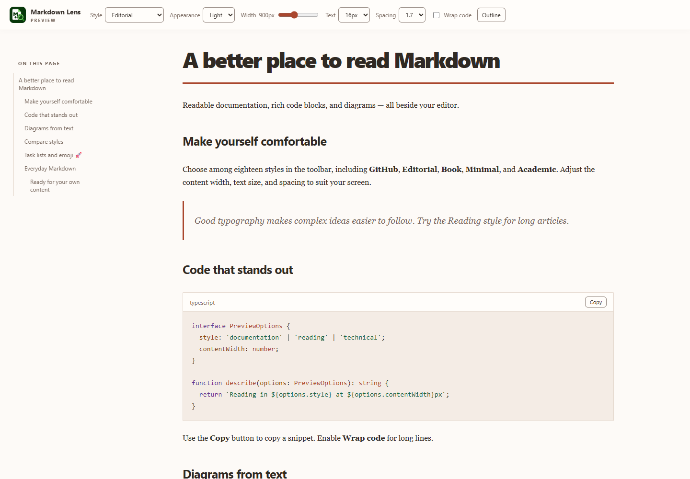
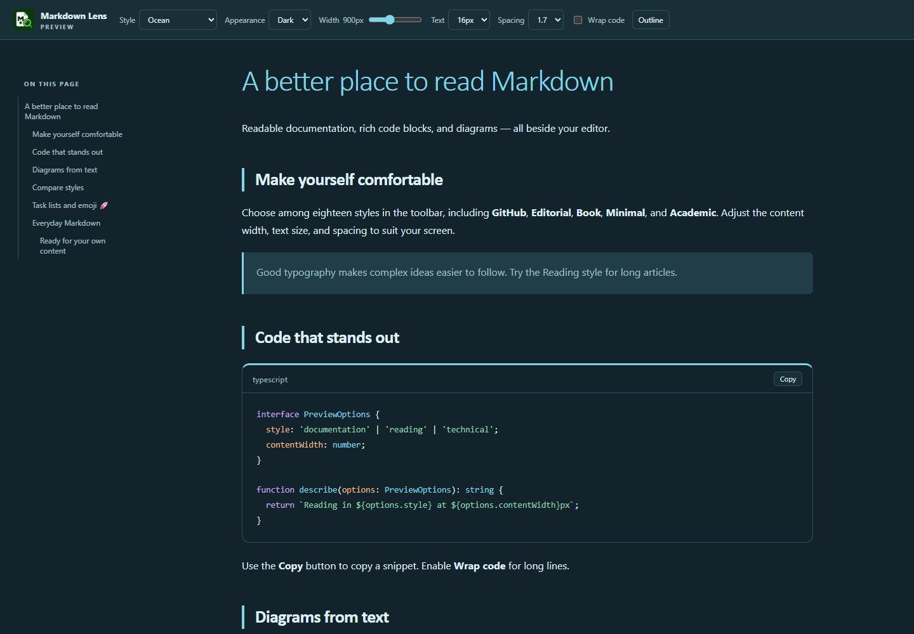
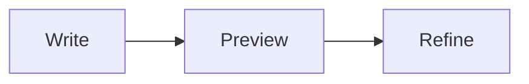

# Markdown Lens

**A Styled Markdown Preview for Visual Studio Code** · by **Kasun Kodagoda**

Turn Markdown into a comfortable reading experience beside your editor. Markdown Lens combines **18 reading styles**, live Markdown preview, syntax highlighting, **Mermaid diagrams**, and interactive tables. Use it for READMEs, documentation, technical notes, articles, and research.



## Get started

1. Install **Markdown Lens - A Styled Markdown Preview** from the VS Code Extensions view. Requires VS Code **1.95 or newer**.
2. Open a Markdown file (`.md`).
3. Right-click in the editor and choose **Open in Markdown Lens**. The preview opens beside your source.
4. Choose a **Style** and **Appearance** in the preview toolbar. Edit your Markdown to see live updates.

You can also right-click a Markdown file in **Explorer**, use the **Open in Markdown Lens** action in the editor title bar, or open the **Command Palette** (`Ctrl+Shift+P` on Windows/Linux, `Cmd+Shift+P` on macOS) and run **Open in Markdown Lens**. Opening the same file again brings its existing preview into view.

## Features

- **18 styles:** Documentation, Reading, Technical, GitHub, Editorial, Book, Minimal, Academic, Swiss, Aurora, Botanical, Noir, Blueprint, Terracotta, Atelier, Ocean, Manuscript, and Circuit.
- **Light, dark, or automatic appearance:** Auto follows the VS Code theme, including diagram colors.
- **Reading controls:** Adjust content width, text size, and line spacing; wrap long code lines; show or hide the heading outline.
- **Live preview:** Updates while typing and keeps the preview's scroll position.
- **Code highlighting:** Language labels, readable syntax colors, and a Copy button on fenced code blocks.
- **Mermaid diagrams and charts:** Rendered locally with colors coordinated to your reading style.
- **Interactive tables:** Sort columns, search rows, choose spacing, and copy or export the visible data as CSV.
- **Heading navigation:** Jump to sections using the outline or heading links.
- **Extended Markdown:** Task lists, emoji shortcodes, footnotes, definition lists, highlighted text, subscript, superscript, and GitHub-style callouts.
- **Links and images:** Local file links open in VS Code. Relative images load from the document directory; HTTPS images are supported.
- **Offline rendering:** Styles, syntax highlighting, and Mermaid are bundled. No CDN or account is needed. Remote images and external links use your network connection.



## Make it yours

Use the toolbar to change **Style**, **Appearance**, **Width**, **Text**, **Spacing**, and **Wrap code**. The **Outline** button toggles section navigation. Width updates as you drag; it saves when you release the slider.

Reading preferences save for the file's workspace folder, or globally for standalone files. If a settings file cannot be saved, the preview keeps your selection for the current session and shows a warning.

You can also search for **Markdown Lens** in VS Code Settings. The settings identifiers remain `styledMarkdown.*` so existing preferences continue to work:

| Setting | Default | Options |
| --- | --- | --- |
| `styledMarkdown.style` | `documentation` | Any of the 18 styles |
| `styledMarkdown.appearance` | `auto` | `auto`, `light`, `dark` |
| `styledMarkdown.contentWidth` | `900` | 480–1600 pixels |
| `styledMarkdown.fontSize` | `16` | 12–24 pixels |
| `styledMarkdown.lineHeight` | `1.7` | 1.3–2.2 |
| `styledMarkdown.wrapCode` | `false` | `true` or `false` |

All styles use system fonts; their exact appearance can vary by operating system.

## Work with tables

- Click a header to cycle through **ascending**, **descending**, and **original order**. Numbers sort numerically, text sorts naturally, and blank cells stay last.
- Type in **Search** to filter rows across every column. **Reset** clears search and restores source order.
- Choose **Comfortable** or **Compact** spacing separately for each table.
- Long tables have sticky headers. Wide tables scroll horizontally; focus the table region to scroll with the keyboard.
- **Copy CSV** and **Export CSV** include the header and currently visible rows in their current order. Export uses VS Code's Save dialog and UTF-8 with a BOM. Formula-like text is escaped for spreadsheet applications.

Table search, sort, and spacing survive live updates when the table's position and column headers stay the same.

## Write rich Markdown

Add a Mermaid diagram using a fenced block:

````markdown

````

Task lists (`- [ ]` and `- [x]`) display read-only checkboxes. Change their state in the source. Emoji such as `:rocket:` and `:white_check_mark:` work in prose; code keeps its literal text.

Use `==highlighted text==`, `H~2~O`, `x^2^`, and footnotes (`[^note]`). For a callout:

```markdown
> [!TIP]
> Choose Reading or Book for longer articles.
```

Supported callouts: **Note**, **Tip**, **Important**, **Warning**, and **Caution**. Raw HTML is shown as text; scripts in Markdown are not executed.

## Current limits

The preview scrolls independently of the source editor. Full-document PDF/HTML export, math typesetting, custom CSS, and editable task checkboxes are not available in this release. CSV table export is supported. Images outside the document's directory are not supported. Preview panels must be reopened after restarting VS Code. Very large files or many diagrams may take longer to render.

## License

Markdown Lens is available under the [MIT License](LICENSE).

[Developer documentation and release instructions](DEVELOPMENT.md)
