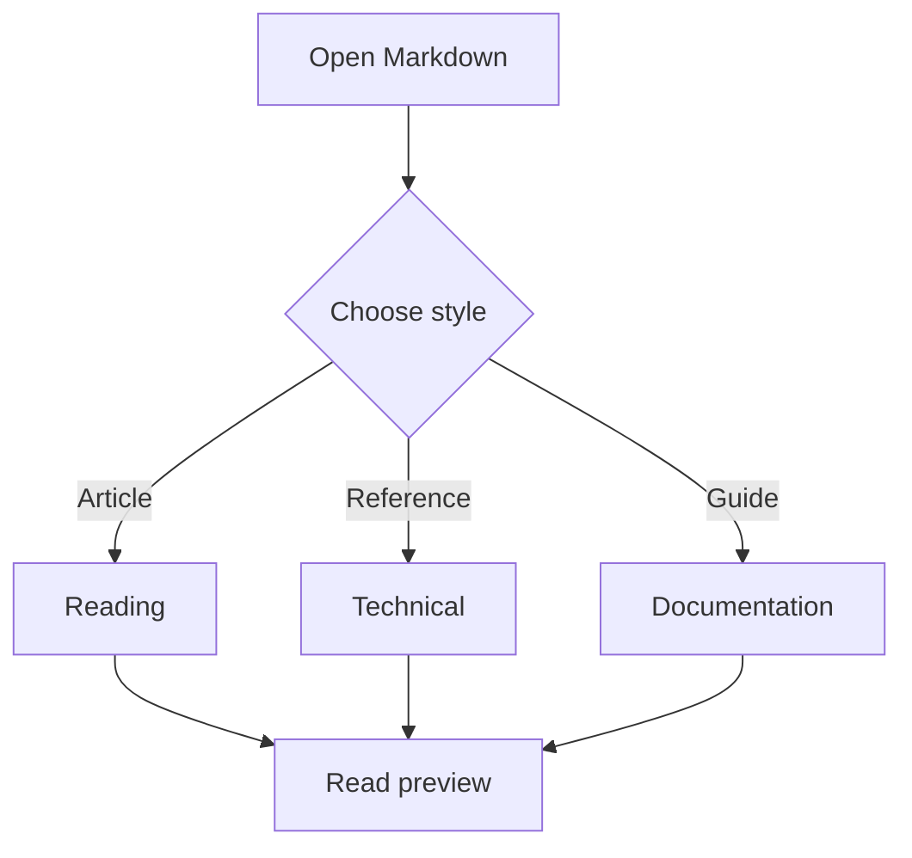
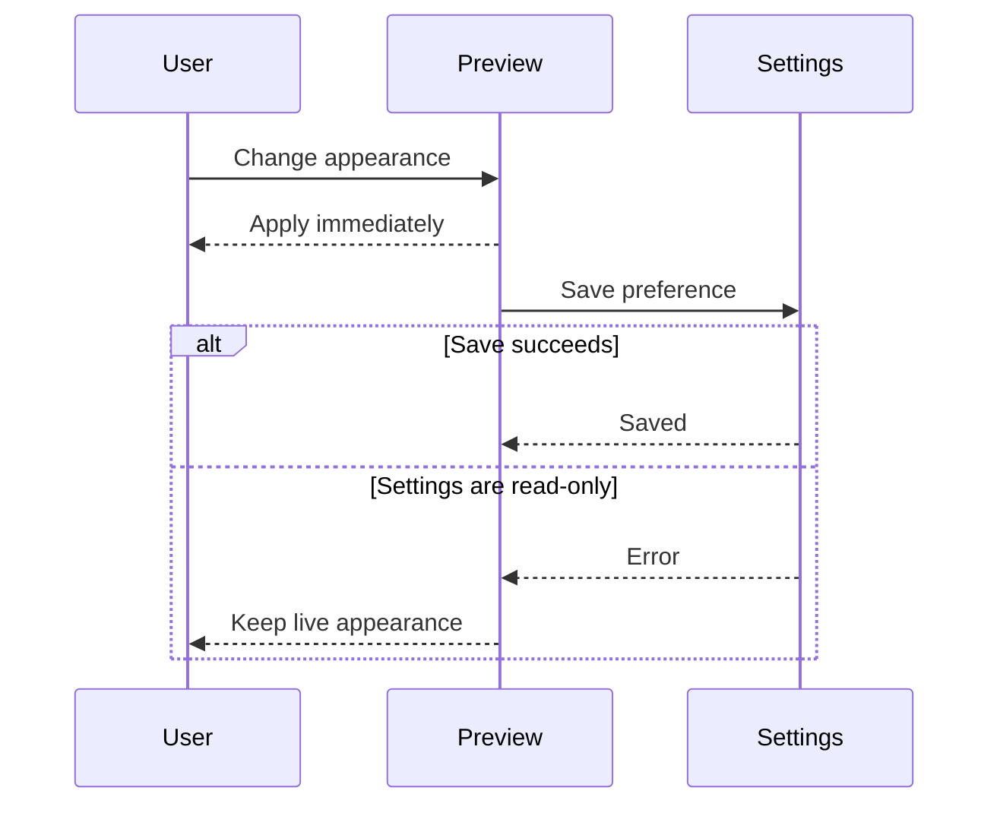
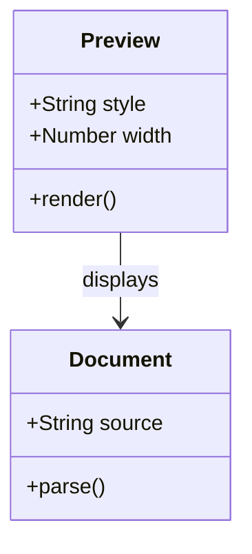
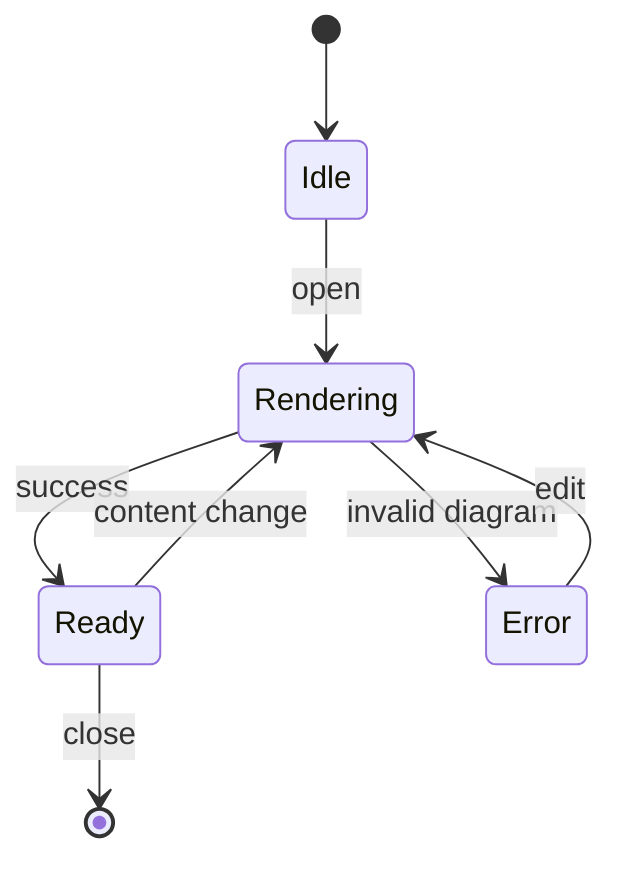
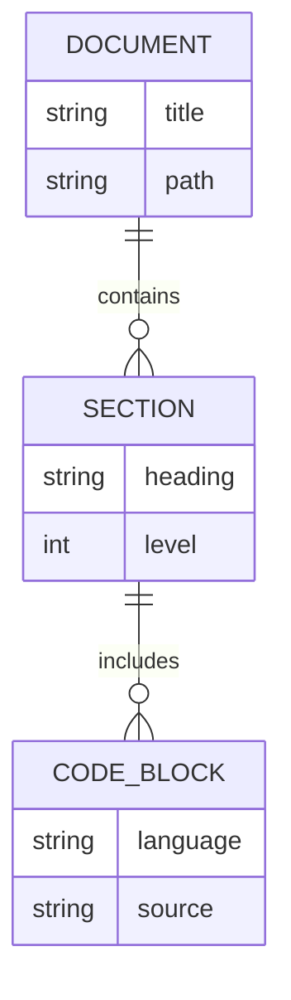
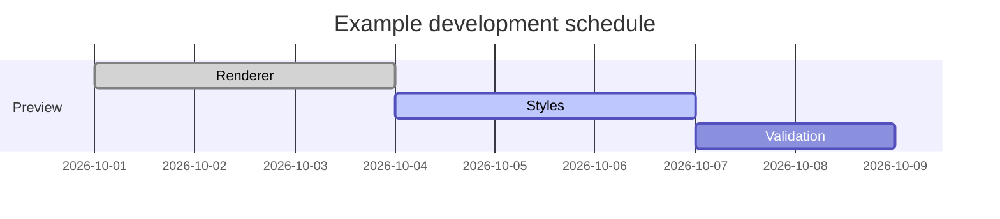
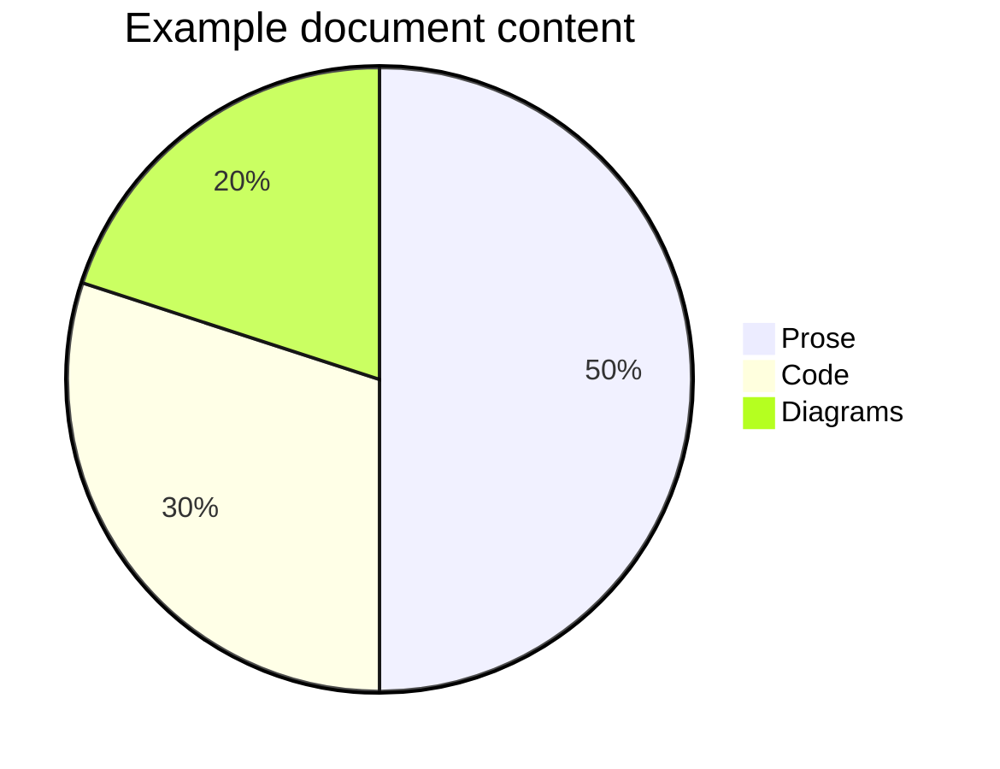
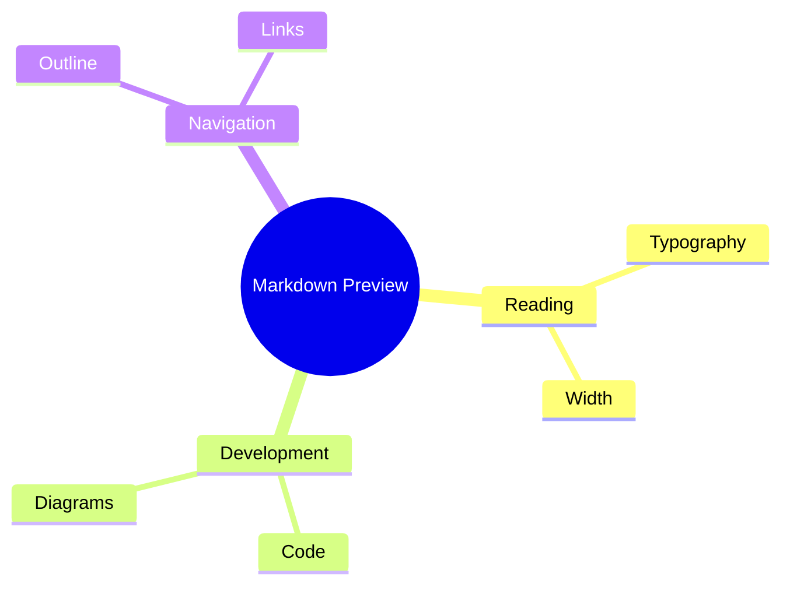
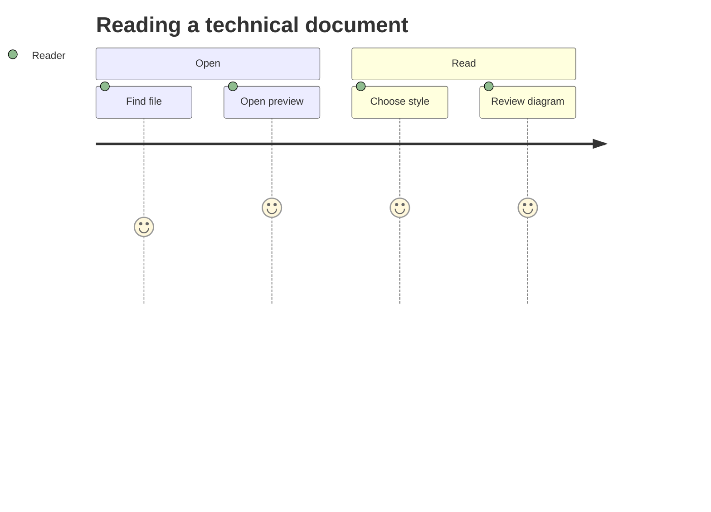

# Mermaid diagrams

**Expected:** valid diagrams render locally. Switching Light/Dark recolors diagrams. Width and typography changes should not recreate diagrams. The final diagram is intentionally invalid.

## Flowchart



## Sequence diagram



## Class diagram



## State diagram



## Entity relationship diagram



## Gantt chart



## Pie chart



## Mind map



## User journey



## Intentional invalid syntax

```mermaid
flowchart TD
  A[An unclosed node
  A -->
```

## Content after the error

This heading and paragraph should still render. The invalid diagram should show its source and an error message.
