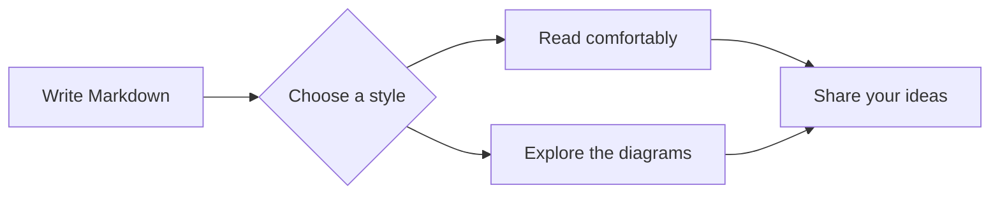
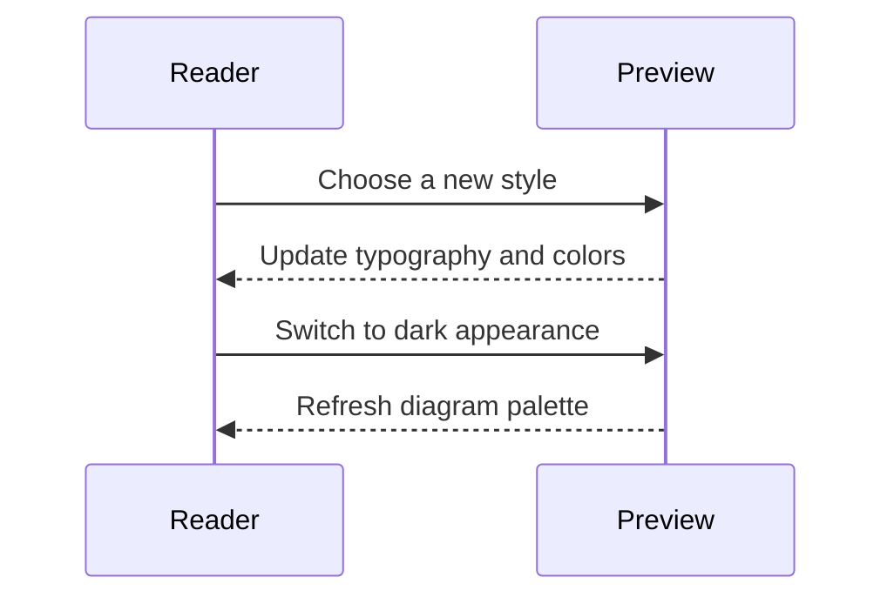
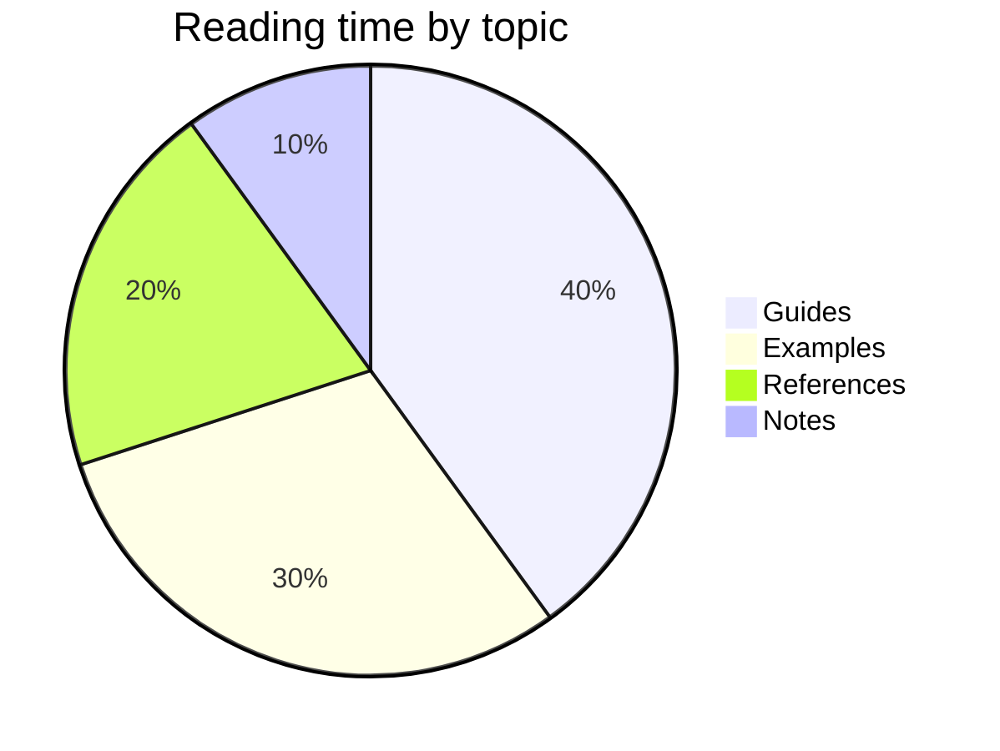
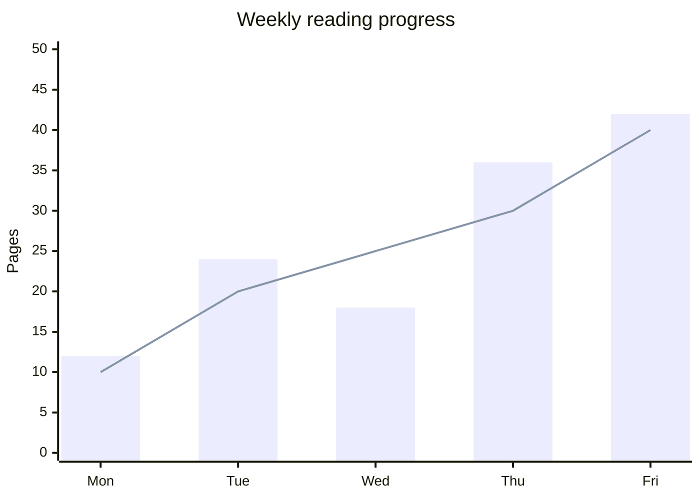

# Typography in motion

A good reading surface gives every idea room to breathe. Switch between the eighteen styles to compare the title, section markers, body type, code frames, and diagram palettes. All fonts are local; the preview also works offline.

## A clear visual hierarchy

This is the body text: comfortable, unhurried, and easy to scan. **Strong emphasis** draws attention to a useful detail, while *italics* give a phrase a softer voice. Inline code such as `renderMarkdown(source)` keeps its transparent background.

### A supporting idea

Headings should look different from paragraphs and from one another. Some presets use expressive serif titles, others use graphic rules, small capitals, or precise monospaced section labels.

#### A practical detail

Use the text size and line spacing controls to find your preferred rhythm.

##### A smaller point

All six heading levels stay in the document outline.

###### A final annotation

> Typography is the quiet architecture of a page.

## Code with room to breathe

```typescript
interface ReadingStyle {
  name: string;
  comfortable: boolean;
}

// A small function with clearly separated syntax colors.
function chooseStyle(styles: ReadingStyle[]): string[] {
  const limit = 10;
  return styles
    .filter(style => style.comfortable)
    .slice(0, limit)
    .map(style => `Try ${style.name}`);
}
```

```json
{ "style": "ocean", "fontSize": 18, "wrapCode": true }
```

## Diagrams that belong on the page





## Charts in the same palette





## Structured information

| Style family | Example | Reading character |
| --- | --- | --- |
| Graphic | Swiss, Blueprint, Circuit | Confident rules and precise structure |
| Literary | Botanical, Terracotta, Manuscript | Graceful serif headings |
| Expressive | Aurora, Noir, Atelier | Distinct display titles |
| Airy | Ocean | Open, humanist typography |

> [!TIP]
> Compare light and dark appearance, then try a narrow preview and wrapped code. Style changes preserve your reading position.
