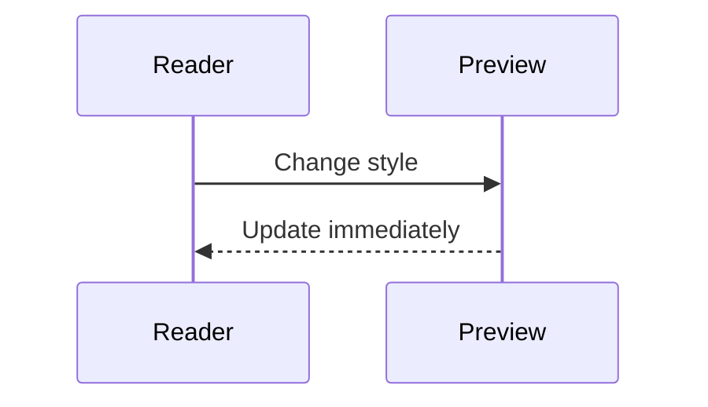
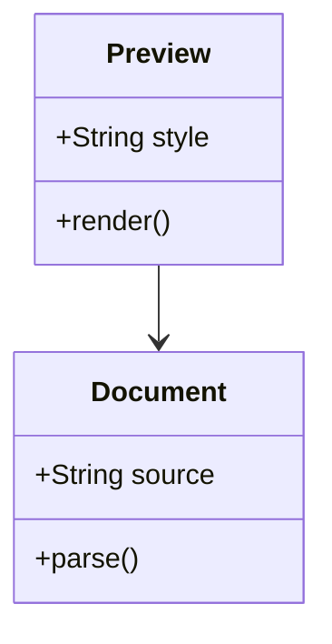
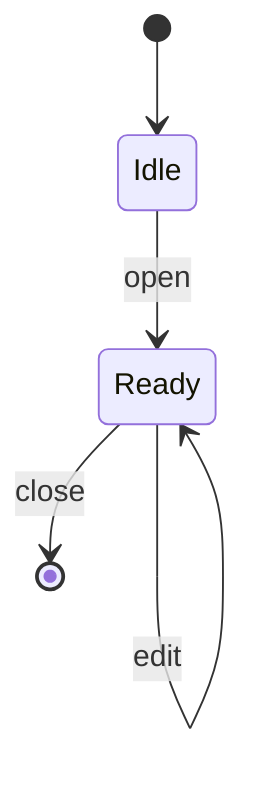
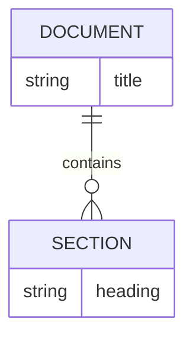
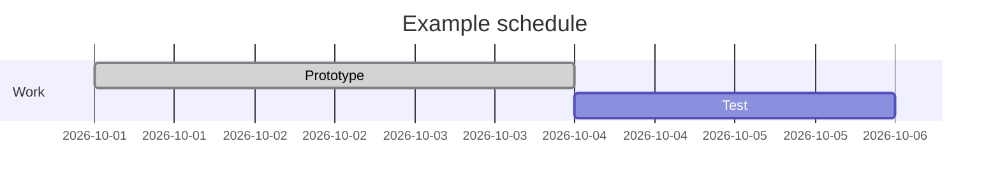
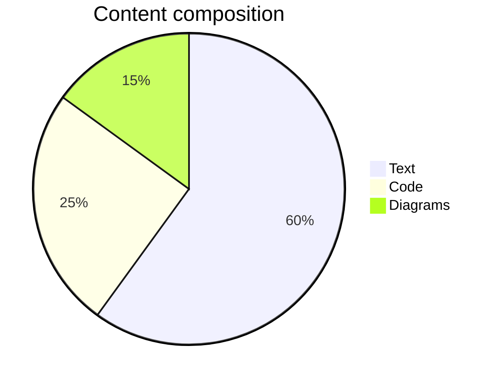
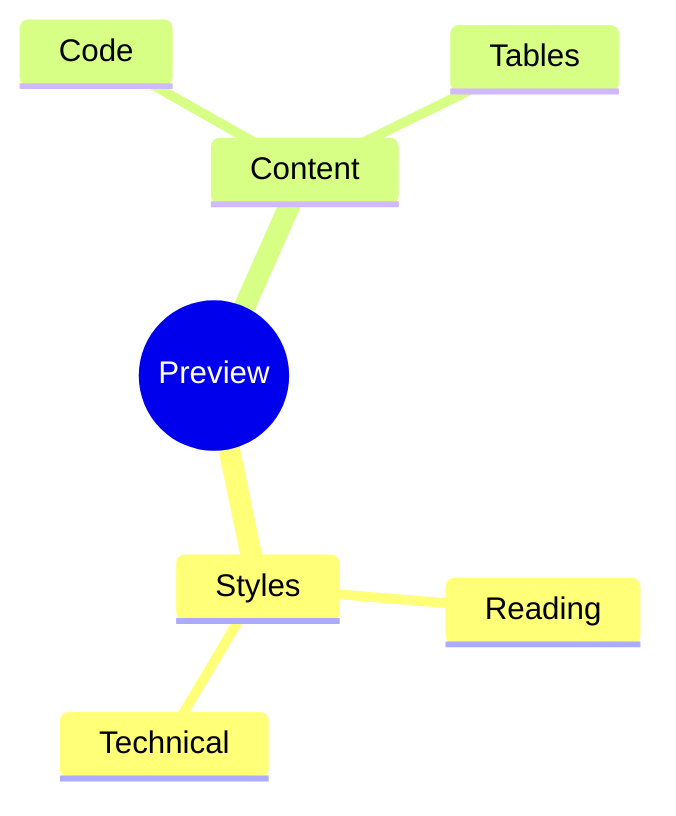
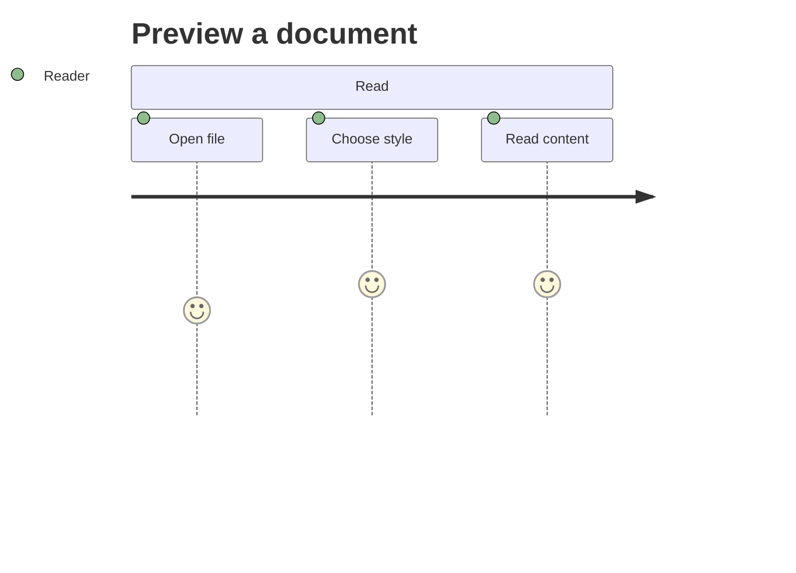

# Master Markdown preview test

This is a comprehensive manual fixture for the extension. Markdown has multiple dialects; no universal file can cover every vendor-specific extension. Core constructs and common extensions are included here, with unsupported features clearly labeled.

**Start here:** switch styles and appearance, drag the width slider, change text size and spacing, toggle code wrapping, and navigate through the outline. See [the test guide](README.md) for expected results.

## Table of contents

- [Headings](#headings)
- [Paragraphs and inline formatting](#paragraphs-and-inline-formatting)
- [Lists](#lists)
- [Blockquotes](#blockquotes)
- [Horizontal rules](#horizontal-rules)
- [Code blocks](#code-blocks)
- [Tables](#tables)
- [Links](#links)
- [Images](#images)
- [Mermaid diagrams](#mermaid-diagrams)
- [Extended Markdown and optional syntax](#extended-markdown-and-optional-syntax)
- [HTML safety](#html-safety)
- [Edge cases](#edge-cases)

## Headings

# Level one heading

## Level two heading

### Level three heading

#### Level four heading

##### Level five heading

###### Level six heading

Setext level one
===============

Setext level two
---------------

### Heading with **bold**, *italic*, and `code`

### Unicode heading 日本語 සිංහල 🚀

### Repeated heading

First target.

### Repeated heading-1

Literal suffix collision test.

### Repeated heading

Second duplicate target; each outline entry should navigate separately.

## Paragraphs and inline formatting

This paragraph is intentionally long enough to span several lines at narrower widths. Good Markdown rendering should make the relationship between headings, paragraphs, lists, code, and diagrams clear without overwhelming the reader. Compare Documentation with Reading and Technical, then adjust line height and font size while keeping this section on screen.

A blank line starts a new paragraph. *Italic*, _italic with underscores_, **bold**, __bold with underscores__, ***bold italic***, **nested *emphasis***, and ~~strikethrough~~ should all be readable.

Inline code: `npm run build`. A backtick inside a code span: ``a `nested` backtick``. Code punctuation: `<tag> & "quoted"`.

Soft break follows this sentence.
This remains part of the same paragraph.

Two trailing spaces create a hard break.  
This line should begin below the previous one.

A backslash also creates a hard break.\
This line should also begin below the previous one.

Escapes: \*literal asterisks\*, \_literal underscores\_, \[literal brackets\], \# literal hash, \\ literal backslash.

Entities: &amp; &lt; &gt; &quot; &copy; &#169; &#x1F680;.

Typographic replacements: "double quotes", 'single quotes', --, ---, ..., (c), (r), (tm).

Unicode and bidirectional text: café · naïve · 日本語 · සිංහල · العربية · Ελληνικά · 🚀 · 👩‍💻.

## Lists

- Unordered item
- Item with **bold** and `inline code`
  - Nested child
    - Third-level child
- Final item

* Asterisk marker
* Another asterisk item

+ Plus marker
+ Another plus item

7. Ordered list starting at seven
8. Next item
   1. Nested ordered item
   2. Another nested item
9. Final ordered item

1) Parenthesis marker
2) Second item

- Loose item, first paragraph.

  Second paragraph inside the same item.

- Another loose item.

  > Nested quotation.

  ```text
  Nested code block.
  ```

  | Nested | Table |
  | --- | --- |
  | One | Two |

## Blockquotes

> A quotation with **strong emphasis** and *italic emphasis*.
>
> A second paragraph in the same quotation.
>
> > A nested quotation.
>
> - A list inside a quotation
> - Another item
>
> ```text
> Code inside a quotation.
> ```

## Horizontal rules

Dash rule:

---

Asterisk rule:

***

Underscore rule:

___

## Code blocks

### TypeScript

```typescript
type Style = 'documentation' | 'reading' | 'technical';

function preview(style: Style, width = 900): string {
  return `Style: ${style}; width: ${width}px`;
}

console.log(preview('reading'));
```

### Python

```python
def headings(document: str) -> list[str]:
    """Extract simple ATX headings for this example."""
    return [line for line in document.splitlines() if line.startswith('#')]
```

### JSON

```json
{
  "style": "technical",
  "appearance": "dark",
  "width": 720,
  "wrapCode": true,
  "labels": ["日本語", "සිංහල", "🚀"]
}
```

### HTML and CSS source

```html
<section class="document">
  <h1>Readable &amp; accessible</h1>
</section>
```

```css
.document { max-width: 900px; margin: 0 auto; }
```

### SQL and shell source

```sql
SELECT style, COUNT(*) FROM documents GROUP BY style;
```

```bash
# Display-only code fixture.
printf '%s\n' 'Hello, Markdown'
```

### Unknown language

```unknown-language
<tag attribute="value">Escape HTML & keep it visible</tag>
```

### No language

```
Plain code: < > & " ' ` $ { } [ ]
```

### Tilde fence

~~~text
Tilde-delimited code block.
~~~

### Nested fence demonstration

````markdown
```javascript
const answer = 42;
```
````

### Indented code

    Four-space indentation creates a code block.
    It does not currently have a fenced-code copy toolbar.

### Long code line

```text
https://example.com/documents/markdown-preview/technical/reference/long-path/another-segment?style=documentation&appearance=dark&contentWidth=1600&fontSize=24&lineHeight=2.2&wrapCode=false
```

### Empty code block

```text
```

## Tables

### Alignment

| Left | Center | Right |
| :--- | :---: | ---: |
| Text | Middle | 100 |
| Another row | Centered | 3.14 |

### Formatted and empty cells

| Type | Value | Notes |
| --- | --- | --- |
| Emphasis | **bold**, *italic*, ~~removed~~ | Inline formatting |
| Code | `const answer = 42` | Monospace |
| Pipe | left \| right | Escaped separator |
| Code pipe | `left \| right` | Escaped inside code |
| Link | [Example](https://example.com) | Navigation |
| Unicode | 日本語 · සිංහල · 🚀 | Font fallback |
| Empty | | Blank value |

### Wide table

| ID | Name | Owner | Date | Status | Environment | Long description | Reference |
| --- | --- | --- | --- | --- | --- | --- | --- |
| TEST-001 | Markdown readability | Documentation | 2026-10-07 | Ready | Local | This long sentence tests how the preview handles many columns and content that should wrap or scroll in a narrow editor. | `markdown/preview/documentation/readability/test-001` |
| TEST-002 | Diagram visualization | Engineering | 2026-10-08 | Review | Workspace | Compare this row across all eight styles and both appearances. | `markdown/preview/technical/diagram/test-002` |

### Table without outside pipes

Name | Value
--- | ---
Width | 900

### Irregular row lengths

| A | B | C |
| --- | --- | --- |
| Short | Row |
| Extra | Cells | Here | Ignored |

## Links

[External link](https://example.com "Link title") · [Local file](01-typography-and-lists.md) · [Filename with spaces](assets/linked%20note.md).

[Cross-file fragment](assets/linked%20note.md#link-target) currently opens the file without jumping to the heading.

[Reference link][reference-link] · [Collapsed reference][] · [Shortcut reference].

[reference-link]: https://code.visualstudio.com/docs "VS Code documentation"
[Collapsed reference]: https://example.com/collapsed
[Shortcut reference]: https://example.com/shortcut

Autolink: <https://example.com>. Email autolink: <reader@example.invalid>.

Bare URL: https://example.com/path?style=reading&width=900.

[Jump back to headings](#headings) · [Jump forward to images](#images).

## Images

### Local image


### Reference image

![Reference image][local-image]

[local-image]: assets/preview-test.svg "Reference image title"

### Linked image

[](assets/linked%20note.md)

### Optional remote image

Requires network access and an available external image service.


### Intentionally broken image


## Mermaid diagrams

### Flowchart


### Sequence



### Class



### State



### Entity relationship



### Gantt



### Pie



### Mind map



### Journey



### Invalid diagram — intentional

```mermaid
flowchart TD
  A[Unclosed node
  A -->
```

The invalid diagram should show an error and source; this paragraph must remain visible.

## Extended Markdown and optional syntax

Task lists, footnotes, definition lists, emoji, highlights, subscript/superscript, and GitHub-style callouts are supported. Math, custom attributes, metadata handling, and colon containers remain literal fallback cases.

### Task lists

- [ ] Pending task
- [x] Completed task
  - [ ] Nested task

### Footnotes

A sentence with a footnote.[^master-footnote]

[^master-footnote]: A numbered footnote with a backlink to its reference.

### Definition lists

Term
: Definition text.

### Math

Inline math: $E = mc^2$.

$$
\sum_{i=1}^{n} i = \frac{n(n+1)}{2}
$$

```math
f(x) = x^2
```

### Extended inline notation

Emoji shortcodes: :rocket: :warning:. Native emoji: 🚀 ⚠️.

==Highlighted text== · H~2~O · x^2^ · [Attribute link](https://example.com){.button}.

### Admonitions and containers

> [!NOTE]
> This renders as a labeled Note callout.

> [!WARNING]
> A fixture for a styled Warning callout.

::: tip
Extended container syntax is not implemented.
:::

### Metadata

YAML front matter appears at the start of this file. It is currently ordinary Markdown, without special metadata handling.

## HTML safety

Raw HTML is escaped, not executed. These examples should display literal tags.

<div class="panel"><strong>Raw HTML panel</strong></div>

<details>
<summary>Details disclosure</summary>
This does not become an interactive disclosure in this version.
</details>

<!-- An HTML comment should be visible as text with raw HTML disabled. -->

<script>alert('This must never execute')</script>


<iframe src="https://example.com"></iframe>

<video controls src="sample.mp4"></video>

<audio controls src="sample.mp3"></audio>

[Unsafe JavaScript link](javascript:alert%281%29)

[Command link must not run](command:workbench.action.closeWindow)

## Edge cases

### Incomplete inline syntax

Unfinished *emphasis.

Unfinished **strong emphasis.

Unfinished `inline code.

[Incomplete link](

### Long unbroken text

abcdefghijklmnopqrstuvwxyz0123456789abcdefghijklmnopqrstuvwxyz0123456789abcdefghijklmnopqrstuvwxyz0123456789abcdefghijklmnopqrstuvwxyz0123456789abcdefghijklmnopqrstuvwxyz0123456789

### !!!

Punctuation-only heading; inspect its outline target.

### Duplicate heading

First duplicate.

### Duplicate heading

Second duplicate.

### Non-table syntax

| Name | Value |
| Missing | Separator row |

### Final rendering checkpoint

If you can read this paragraph after switching themes and editing earlier sections, the preview still renders content after intentional error cases. The separate [edge-case file](06-edge-cases-and-extensions.md) ends with an unclosed fence; this master file stays well-formed so later sections remain testable.
