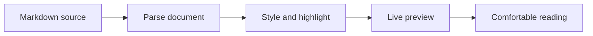
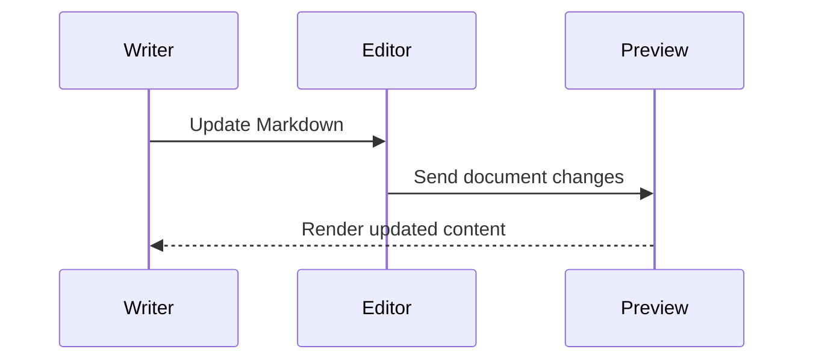

# A better place to read Markdown

Readable documentation, rich code blocks, and diagrams — all beside your editor.

## Make yourself comfortable

Choose among eighteen styles in the toolbar, including **GitHub**, **Editorial**, **Book**, **Minimal**, and **Academic**. Adjust the content width, text size, and spacing to suit your screen.

> Good typography makes complex ideas easier to follow. Try the Reading style for long articles.

## Code that stands out

```typescript
interface PreviewOptions {
  style: 'documentation' | 'reading' | 'technical';
  contentWidth: number;
}

function describe(options: PreviewOptions): string {
  return `Reading in ${options.style} at ${options.contentWidth}px`;
}
```

Use the **Copy** button to copy a snippet. Enable **Wrap code** for long lines.

## Diagrams from text





## Compare styles

| Style | Best for | Character |
| :--- | :--- | :--- |
| Documentation | READMEs and guides | Clear headings and balanced spacing |
| Reading | Articles and essays | Serif typography and generous paragraphs |
| Technical | API notes and references | Compact headings and tables |
| GitHub | READMEs | Familiar system typography |
| Editorial | Articles | Bold headlines and serif prose |
| Book | Essays | Warm paper and classic serif text |
| Minimal | Notes | Quiet sans-serif and whitespace |
| Academic | Research | Formal headings and ruled tables |

## Task lists and emoji :rocket:

- [x] Completed task
- [ ] Pending task with **bold text** and :smile:

> [!NOTE]
> Task checkboxes display their source state. Edit the Markdown to change it.

## Everyday Markdown

1. Open a Markdown file.
2. Right-click and choose **Open in Rich Markdown Preview**.
3. Keep writing — the preview updates automatically.

- **Strong emphasis**, *gentle emphasis*, and ~~strikethrough~~.
- Inline code such as `npm run build`.
- [VS Code documentation](https://code.visualstudio.com/docs).
- Nested lists:
  - Keep related ideas together.
  - Give each section a descriptive heading.

---

### Ready for your own content

Try editing this file with the preview open. Your preferences are saved in VS Code settings.
